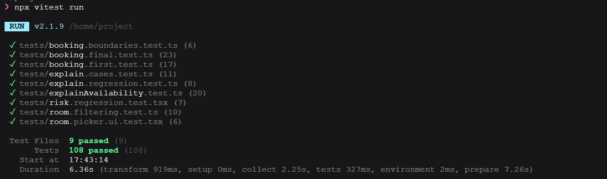
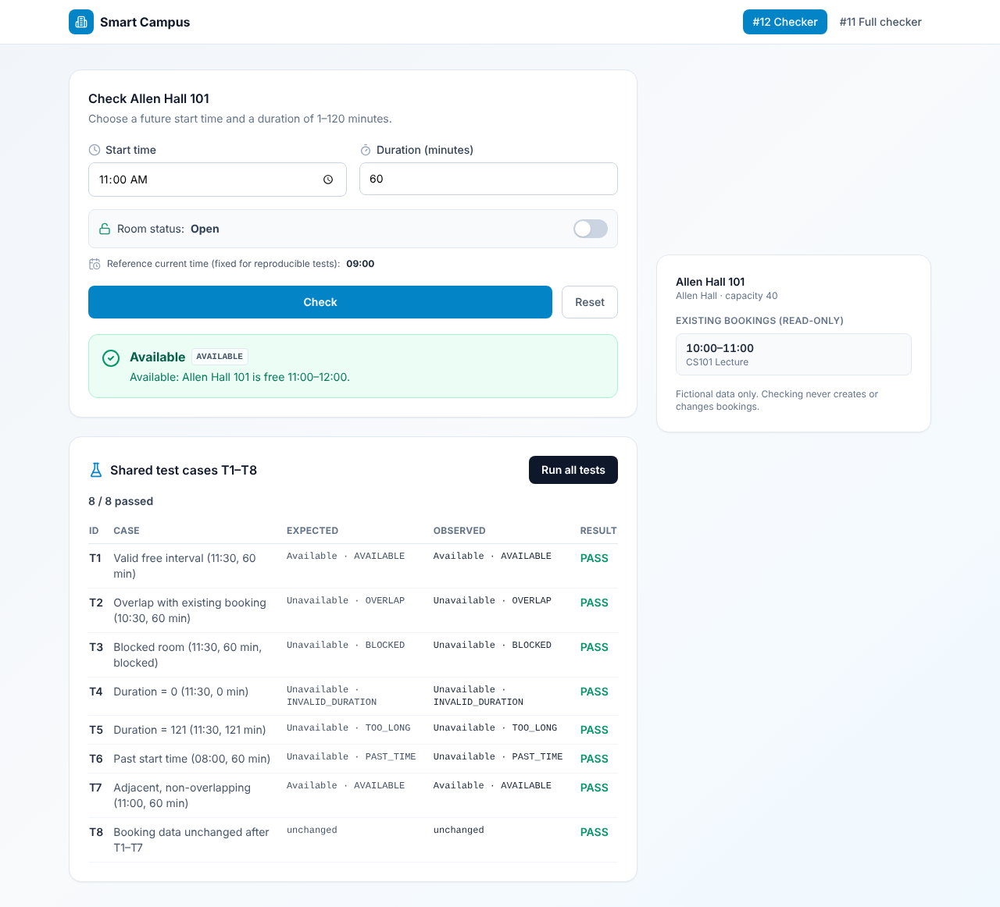
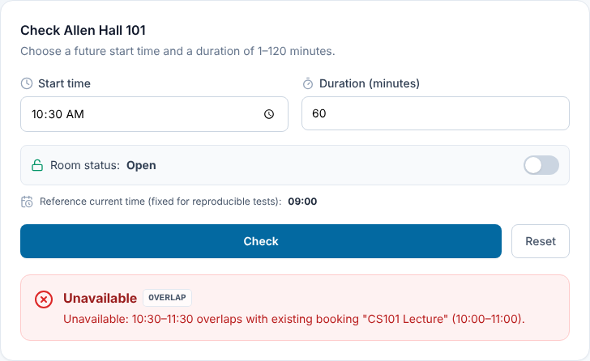
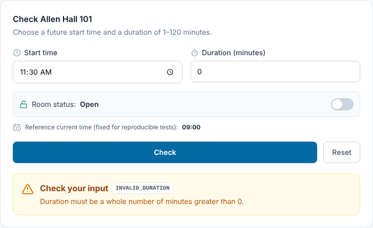
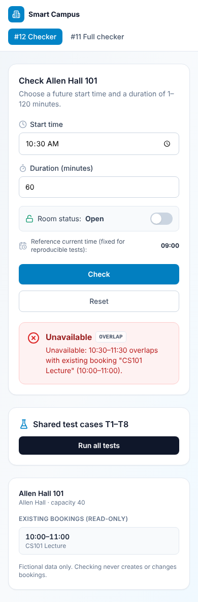
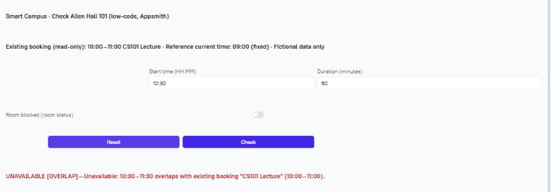
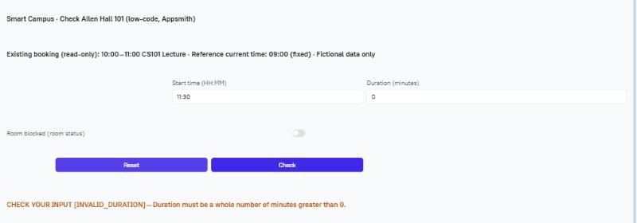
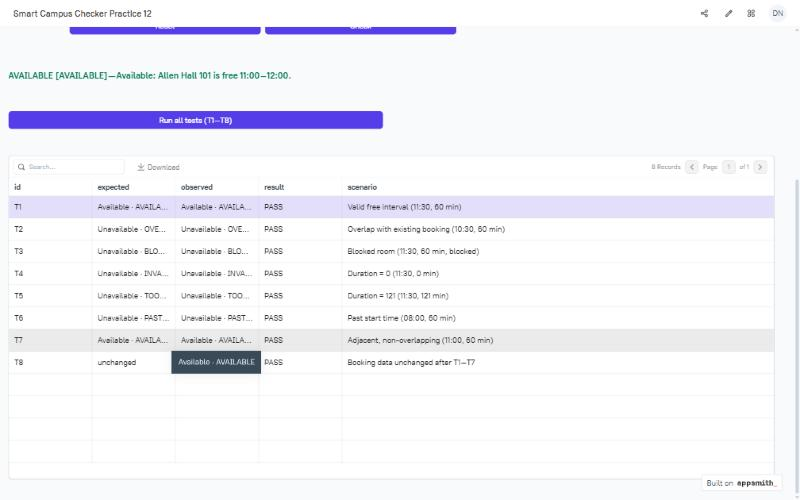
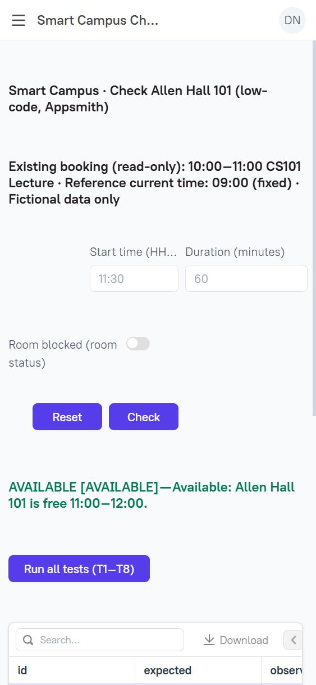

# Practice #12 — Code-based vs Low-code: Smart Campus Room Availability Checker

| Field | Value |
|---|---|
| Student | Daniyal Nurtaza, ID 24B031075 |
| Course | AI-Driven Software Engineering, Practice #12 (Lesson #12) |
| Class time | Tuesday, 16:00–19:00 |
| AI tool | Claude Opus 5.5 (Anthropic, model `claude-opus-5-5`), claude.ai app with browser and shell tools, 2026-11-24 |
| Repository | GitHub public repository (link in README) — source, report, evidence, Appsmith export |
| Live demo, code-based | GitHub Pages, deployed by `.github/workflows/pages.yml` (link in README) |
| Live demo, low-code | https://app.appsmith.com/app/smart-campus-checker-practice-12/page1-6b058982b238dbe867c49d06 (public) |
| Low-code export | `lowcode/appsmith-export.json` |

> ⚠️ AI-BUILT: The low-code (Appsmith) solution was built by the AI agent (Claude), not by the student. The agent operated the Appsmith editor through the browser on the student's own Appsmith account after the student signed in; the student approved making the app public. All low-code timings in this report are the AI agent's timings, not human build times.

> ⚠️ AI-BUILT: The code-based changes (contract module, UI, tests, CI workflow, dependency removal) were also generated by the AI agent and reviewed by the student before submission.

---

## Task 01 — Freeze the baseline

| Item | Value |
|---|---|
| Source | Bolt.new export of the Practice #11 Smart Campus checker |
| Version | git tag `practice12-baseline` = commit `6e1923b` |
| Stack | React 18.3.1, TypeScript 5.6.3, Vite 5.4.8, Vitest 2.1.9, Tailwind 3.4 (Node 22.23.5, npm 10.9.9) |
| Rule engine | `src/booking.ts` → `checkAvailability(room, start, end, currentTime, bookings)` (AC1–AC4 of Practice #11) |
| Booking data | `src/sampleData.ts`: 6 fictional rooms, 3 bookings; Practice #12 uses room `r1` Allen Hall 101 with booking `b1` 10:00–11:00 "CS101 Lecture" |
| Expected behaviour | Available/Unavailable decision with reasons; never mutates fixtures |

| Check | Result (`evidence/01_baseline_checks.txt`) |
|---|---|
| `npm test` | 9 files, **108 passed** (also on the student's machine, screenshot below) |
| `npm run typecheck` | exit 0 |
| `npm run lint` | exit 0 |
| `npm run build` | built in 2.40 s, JS bundle 172.36 kB |

Booking rules were not changed: `git diff practice12-baseline HEAD -- src/booking.ts src/sampleData.ts src/types.ts` is empty (`evidence/07_security_checks.txt`).

---

## Task 02 — Shared contract (one sheet for both solutions)

Full sheet: `docs/CONTRACT.md` (committed in `dae9fcf` before any implementation).

**User story.** As a student, I want to choose a future start time and a duration for Allen Hall 101 and immediately see whether it is Available or Unavailable with a clear reason, so that I can plan a study session without changing anyone's booking.

| ID | Acceptance criterion |
|---|---|
| AC1 | Start time must be in the future (strictly after the reference time 09:00). |
| AC2 | Duration must be greater than zero and at most 120 minutes. |
| AC3 | Overlapping bookings are unavailable; touching endpoints do not overlap. |
| AC4 | A blocked room is unavailable. |
| AC5 | A clear decision is displayed; existing bookings are never changed. |
| AC6 | Invalid input receives understandable feedback. |

| Inputs | Outputs |
|---|---|
| `startTime` HH:MM, `durationMinutes` (raw form value), `blocked` flag, fixed fictional bookings | `available` boolean, `reasonCode` (`AVAILABLE`, `INVALID_START`, `INVALID_DURATION`, `TOO_LONG`, `PAST_TIME`, `OUT_OF_DAY`, `BLOCKED`, `OVERLAP`), visible `message` |

Evaluation order (first failing rule wins): INVALID_START → INVALID_DURATION → TOO_LONG → PAST_TIME → OUT_OF_DAY → BLOCKED → OVERLAP → AVAILABLE. Reference "current time" is fixed at 09:00 in both solutions so that the same inputs give the same results.

---

## Task 03 — Code-based solution

| Layer | File | Responsibility |
|---|---|---|
| Validation | `src/contract/validate.ts` | AC1, AC2, AC6; reads no booking data |
| Availability calculation | `src/contract/checkContract.ts` | calls the unchanged Practice #11 engine `checkAvailability` on a copy of the room; maps result to contract output |
| Test inputs | `src/contract/testCases.ts`, `src/contract/runSharedTests.ts` | T1–T8 shared with the low-code build |
| UI | `src/components/ContractChecker.tsx`, `src/Root.tsx` | form, result panel, in-app T1–T8 runner, tabs (Practice #12 / Practice #11) |
| Tests | `tests/contract.practice12.test.ts` (26), `tests/contract.ui.test.tsx` (5) | contract, boundaries, injection-style input, UI rendering |
| CI / live demo | `.github/workflows/pages.yml` | npm ci → test → typecheck → lint → build → GitHub Pages |

Responsive check (headless Chrome, `evidence/05_code_ui_run.txt`): at 390 px width `document.documentElement.scrollWidth = 390` (no horizontal overflow).

---

## Task 04 — Low-code solution (Appsmith, free cloud plan)

> ⚠️ AI-BUILT: Every step in this section was performed by the AI agent in the browser on the student's Appsmith account.

| Widget | Name | Configuration |
|---|---|---|
| Text | `TitleText`, `BookingsText` | title; read-only booking 10:00–11:00 and reference time 09:00 |
| Input (single-line text) | `StartInput`, `DurationInput` | labels "Start time (HH:MM)", "Duration (minutes)" |
| Switch | `BlockedSwitch` | room-status control, default off |
| Button | `CheckButton`, `ResetButton`, `RunTestsButton` | `{{Checker.check()}}`, `{{Checker.reset()}}`, `{{Checker.runTests()}}` |
| Text | `ResultText` | bound to `appsmith.store.result`; colour expression green / amber / red |
| Table | `TestsTable` | `{{appsmith.store.tests || []}}` |
| JS object | `Checker` | the only script: fixed data, rule evaluation, T1–T8 runner (`lowcode/Checker.js`) |

No datasource, API, connector or login is used (`datasourceList: []` in the export).

**Expressions/scripts used.** One JS object was necessary: Appsmith has no visual block for interval-overlap logic or ordered validation with distinct messages. All other behaviour is widget configuration and `{{ }}` bindings.

**Requirements the platform could not implement as specified (labelled, not simulated):**

| Item | Status |
|---|---|
| Automated test suite | Not available on the free plan as a test framework; T1–T8 run through a JS function inside the app (`Run all tests` button) plus manual runs. No CI. |
| Code review of changes | Widget changes have no reviewable diff in the editor; only the exported JSON can be diffed in git. |
| Narrow screens | Works, but the label "Start time (HH:MM)" is truncated and the table scrolls horizontally at 375 px. |

**Defects found while building the low-code version (debugging phase):**

| # | Defect | Evidence | Fix |
|---|---|---|---|
| D1 | Table column generated from key `case` caused linter error "Unexpected token 'case'" (reserved word) | `evidence/screenshots/lowcode/lc_defect_linter_case.jpg` | key renamed to `scenario` in `Checker.js` |
| D2 | After renaming widgets (`StartInput` → `DurationInput`), Appsmith auto-refactored the JS object to `evaluate(DurationInput.text, DurationInput.text, …)`; every check returned `INVALID_START` | `evidence/screenshots/lowcode/lc_defect_rename_refactor.png` | reference restored to `StartInput.text`, redeployed |

---

## Task 05 — Identical tests (expected vs observed)

Room Allen Hall 101, booking 10:00–11:00, reference time 09:00. Code-based observed values: Vitest (`tests/contract.practice12.test.ts`) and UI run in headless Chrome (`evidence/05_code_ui_run.txt`). Low-code observed values: deployed Appsmith app, manual input (screenshots `lc_T1`–`lc_T7`) and in-app runner (`lc_T8_runner_deployed`).

| ID | Input | Expected | Code-based observed | Low-code observed |
|---|---|---|---|---|
| T1 | 11:30, 60, open | Available · AVAILABLE | Available · AVAILABLE ✔ | AVAILABLE [AVAILABLE] ✔ |
| T2 | 10:30, 60, open | Unavailable · OVERLAP | Unavailable · OVERLAP ✔ | UNAVAILABLE [OVERLAP] ✔ |
| T3 | 11:30, 60, blocked | Unavailable · BLOCKED | Unavailable · BLOCKED ✔ | UNAVAILABLE [BLOCKED] ✔ |
| T4 | 11:30, 0 | Validation error · INVALID_DURATION | Check your input · INVALID_DURATION ✔ | CHECK YOUR INPUT [INVALID_DURATION] ✔ |
| T5 | 11:30, 121 | Validation error · TOO_LONG | Check your input · TOO_LONG ✔ | CHECK YOUR INPUT [TOO_LONG] ✔ |
| T6 | 08:00, 60 | Validation error · PAST_TIME | Check your input · PAST_TIME ✔ | CHECK YOUR INPUT [PAST_TIME] ✔ |
| T7 | 11:00, 60 (adjacent) | Available · AVAILABLE | Available · AVAILABLE ✔ | AVAILABLE [AVAILABLE] ✔ |
| T8 | after T1–T7 | bookings unchanged | unchanged ✔ (fixture deep-equal + JSON snapshot) | unchanged ✔ (JSON snapshot in runner) |

Before defect D2 was fixed, the low-code T1 run returned `INVALID_START` (recorded as an observed failure, then repaired).

---

## Task 06 — Engineering effort

> ⚠️ AI-BUILT: All times below are wall-clock times of the AI agent, taken from git commit timestamps (code-based) and `evidence/lowcode_timing.txt` (low-code). They are not the student's build times and include tool latency.

| Phase | Code-based (measured) | Low-code (measured) |
|---|---|---|
| Setup | ~1.5 min (npm ci, baseline checks, commit 17:43:43) | ~1 min (17:56:09 sign-in confirmed → new app) |
| Implementation | ~3 min (contract 17:44:38 → UI 17:47:50) | ~7.5 min (→ 18:04:38) |
| Debugging | <1 min (1 lint warning: fast-refresh export) | ~2 min (D1, D2; 18:04:38 → 18:06:36) |
| Testing | ~1 min (Vitest + headless UI run) | ~1 min (manual T1–T7, runner, mobile; → 18:07:25) |
| Publish / export | CI workflow written; deploy runs after push | ~3.5 min (deploy, public share incl. waiting for approval, export) |
| Acceptance tests passed | 8 / 8 | 8 / 8 (after repair of D2) |
| Unresolved defects | 0 | 0 functional; 2 UX limitations (truncated label, horizontal table scroll on mobile) |

| Aspect | Code-based | Low-code |
|---|---|---|
| Review of changes | `git diff` per commit; 139 automated tests; CI on every push | Visual editor; no diff in the platform; review only through exported JSON |
| Export | Full source in git | `lowcode/appsmith-export.json` (71,820 bytes), importable into another Appsmith instance |
| Version control | Native git history (7 commits) | Appsmith Git sync was not configured; manual export committed |

**Measured vs impression.** Measured: the times and test counts above. Impression: widget dragging and property editing were the slowest part of the low-code build for an automated agent; a human using the mouse would likely be faster at layout and slower at writing the JS logic. This impression was not measured.

---

## Task 07 — Security review (Lecture #12)

| Check | Code-based | Low-code |
|---|---|---|
| Input validation (injection) | Strict regex `^([01]\d|2[0-3]):([0-5]\d)$`, integer duration; `<script>` as start → INVALID_START (test) | Same regex and checks in `Checker.js` |
| Output handling (XSS) | React escapes text; `grep dangerouslySetInnerHTML|innerHTML|eval(` → no matches; test C-UI4 shows `` rendered as text | Text widget renders plain text; user input is never placed into HTML or JS bindings directly |
| SQL / backend injection | No backend, no database | No datasource, no queries |
| Secrets | `grep` for api key / secret / password / token → only a comment "no secrets"; no `.env` files | Export scanned: no e-mails, no tokens, no credentials |
| Permissions / sharing | Public static site; no write operations exist | App made public (read-only view); edit rights only for the workspace administrator (student); no invited users |
| Connector access | None | None (no datasource, API, connector) |
| SCA (dependencies) | `npm audit --omit=dev`: 1 high (`ws`, via unused `@supabase/supabase-js`) → dependency removed → **0**; full audit after the fix: 24 findings, all in dev dependencies (2 critical: `vitest`/`tinypool`, 13 high incl. `vite`, `postcss`) — not shipped to the browser, fix needs major upgrades | Platform runtime and widget libraries updated by Appsmith (vendor responsibility); student cannot audit or pin them |
| DAST (safe manual runtime) | Own deployed build only: invalid times, 0/121/abc/NaN durations, HTML in fields → validation messages | Own deployed app only: T1–T7 plus invalid input; no scanning of Appsmith infrastructure (not authorised) |
| AI agent least privilege | Agent had shell in an isolated workspace; dependency change flagged for human approval (AGENTS.md rule) | Agent never handled the password (student signed in); public sharing done only after explicit approval |

---

## Comparison matrix

| Criterion | Code-based | Low-code |
|---|---|---|
| Functional tests | **8 / 8** | **8 / 8** (after repairing D2) |
| Build and repair time | ~7 min build + <1 min repair (AI agent) | ~11.5 min build + ~2 min repair (AI agent) |
| Customization | Full control of layout, messages, responsiveness | Widget-level; logic required a JS object; label truncation on mobile not controllable without layout rework |
| Security controls | Automated tests for injection/XSS, SCA via `npm audit`, CI | Relies on platform; no dependency visibility; sharing toggle is a single switch |
| Versioning / portability | Git history, CI, static build runs anywhere | JSON export only; runs only on Appsmith (cloud or self-hosted) |
| Ongoing cost | GitHub Pages free | Appsmith free cloud plan; paid features (Git sync, granular access) not used |

**Recommendation.** For this feature the code-based solution is preferred: it reuses the tested Practice #11 rule engine unchanged, has 139 automated tests and CI, and is fully version-controlled. The low-code solution reached the same 8 / 8 functional result and is suitable for a quick internal prototype, but defect D2 (silent auto-refactor on widget rename) shows that without automated tests and diff review, low-code changes can break logic without warning. Low-code does not remove security responsibility: sharing, data exposure and vendor updates still have to be checked.

---

## AI-use reflection

> ⚠️ AI-BUILT: The AI agent built both solutions; the student defined the task, signed in to Appsmith, approved public sharing and the dependency removal, ran the baseline tests on his machine and reviewed the results.

I used Claude Opus 5.5 in the claude.ai app. It received the Practice #12 PDF, the Bolt.new export of my Smart Campus project and access to a browser on my computer. It wrote the shared contract before any code, built the code-based checker on top of my existing rule engine, and built the Appsmith app itself after I signed in.

The most useful result was that both versions were tested with exactly the same eight inputs, and the low-code logic was checked in Node before it was pasted into Appsmith. The weak point was the Appsmith build: the agent could not drag widgets normally, had to work around the editor, and introduced a real bug by renaming widgets, which Appsmith silently rewrote in the JS code. The in-app test runner did not catch it, because it calls the rule function directly; only the manual test through the form showed the failure. This is why manual runs through the UI are part of the evidence.

What I checked myself: the baseline tests on my machine (108 passed), the public Appsmith link, and the commits before pushing. What should improve next time: build the low-code app by hand to get real human timings, and use Appsmith Git sync so low-code changes can be reviewed as diffs.

## AI-use record

| Step | Prompt summary | Output used | Problem found | Verification |
|---|---|---|---|---|
| 1 | Read Practice #12 PDF, freeze Bolt export as baseline | baseline commit, checks | — | `evidence/01_baseline_checks.txt`, student screenshot |
| 2 | Write shared contract and T1–T8 before implementation | `docs/CONTRACT.md`, `testCases.ts` | — | commit order (`dae9fcf` before `4e760bd`) |
| 3 | Implement code-based contract and UI | `src/contract/*`, `ContractChecker.tsx` | lint warning (fast refresh) | 139 tests, typecheck, lint, build |
| 4 | Security review | removal of unused dependency | `ws` high advisory | `evidence/07_security_*.txt` |
| 5 | Build Appsmith app in the browser | deployed public app, export | D1, D2 | screenshots `lowcode/lc_*`, export scan |
